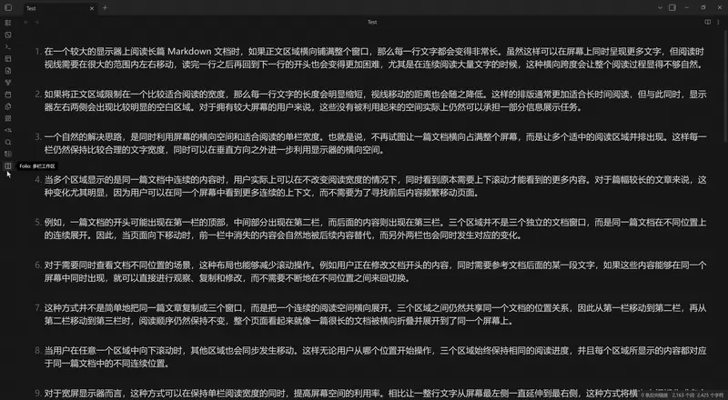
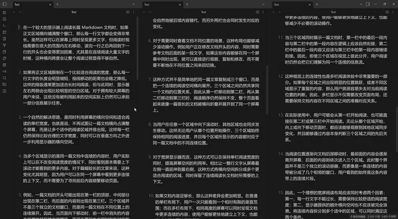

# MultiFolio

<b>A continuous multi-column workspace for seamless reading and editing in Obsidian.</b>

- **Dual Pane Mode** — current view + next screen, synchronized scrolling
- **Triple Pane Mode** — previous + current + next screens, full context while editing
- Works in Edit, Preview, and Source modes

## Demo

## Installation

In Obsidian, open **Settings → Community plugins → Browse**, search for `MultiFolio`, install and enable it.

Manual installation: download the latest release from [GitHub Releases](https://github.com/liyifan2004/obsidian-folio/releases), extract to `.obsidian/plugins/`, then enable it in Settings → Community plugins.

Compatibility: Obsidian v1.8.7+, desktop and mobile.

## Usage

Click the ◪ icon in the left toolbar to open the mode selection menu — Dual Pane, Triple Pane, or Stop.

Recommended hotkeys:

| Action | Hotkey |
|---|---|
| Dual Pane Mode | `Ctrl/Cmd + Shift + D` |
| Triple Pane Mode | `Ctrl/Cmd + Shift + T` |
| Stop synchronized reading | `Ctrl/Cmd + Shift + Q` |
| Page Up / Page Down | `Ctrl/Cmd + ↑` / `Ctrl/Cmd + ↓` |

All commands are also in the Command Palette.

## Languages

The interface follows your Obsidian language setting:

[English](./docs/i18n/en.md) | [简体中文](./docs/i18n/zh.md) | [繁體中文](./docs/i18n/zh-TW.md) | [日本語](./docs/i18n/ja.md) | [한국어](./docs/i18n/ko.md) | [Français](./docs/i18n/fr.md) | [Deutsch](./docs/i18n/de.md) | [Español](./docs/i18n/es.md) | [العربية](./docs/i18n/ar.md)

## Documentation

- [User guide](docs/user-guide.md) — panes, synchronization, settings, use cases
- [Changelog](https://github.com/liyifan2004/obsidian-folio/releases)
- [Issue tracker](https://github.com/liyifan2004/obsidian-folio/issues)

## Credits

Based on the original Folio plugin by [adeyahya](https://github.com/adeyahya). Thanks to the original author for the great idea and implementation.

## License

[MIT](LICENSE)
