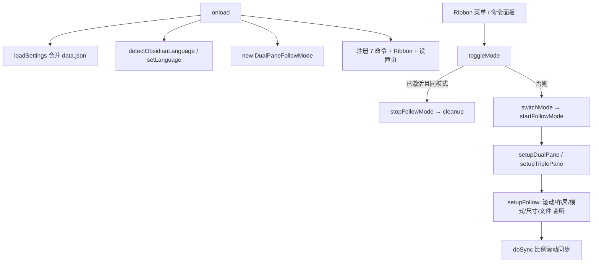

# MultiFolio 功能账簿（Feature Ledger）

本文件是 MultiFolio 插件的长期维护依据，以源码实际行为为准，不以 README 宣传为准。
每次修改代码后必须同步更新受影响条目，并更新文末「更新记录」。

- 对应版本：1.0.3（后续修改会在此标注）
- 建立日期：2026-10-23
- 核对基线：commit `7806944`（工作区无未提交修改时的源码全文核对）

## 状态词典

| 状态 | 含义 |
| --- | --- |
| 已实现 | 源码中有实现且有足够证据支持其行为 |
| 已验证 | 通过测试或可复现的验证（每条注明验证方式与结果） |
| 部分实现 | 只覆盖部分场景，存在明确缺口 |
| 待核实 | 证据不足，无法确认实际行为 |
| 待实现 | 有需求或计划但尚无实现 |

注意：「已实现」≠「已验证」。本仓库的自动化测试覆盖**纯计算逻辑**（滚动几何）与**i18n 一致性**（9 语言键集对齐），涉及真实 Obsidian DOM / 窗格行为的条目仍只能靠源码核对或手动验证（见各条目）。

## 架构速览

| 模块 | 职责 | 行数 |
| --- | --- | --- |
| `main.ts` | 插件入口：生命周期、7 个命令、Ribbon 菜单、设置页注册、设置持久化 | 183 |
| `src/followMode.ts` | 核心引擎 `DualPaneFollowMode`：窗格管理、滚动同步、文件/模式/尺寸监听、清理 | ~950 |
| `src/scrollMath.ts` | 滚动几何纯函数：正向/反向换算、钳制、翻页目标（无 DOM 依赖，可单测） | 108 |
| `src/types.ts` | i18n（9 语言翻译表 + 语言检测）、设置接口与默认值 | ~710 |
| `src/settings.ts` | 设置页（重叠行数滑块 + 静态说明） | 151 |
| `styles.css` | 设置页样式 + 跟随窗格标题后缀标记 | 54 |
| `test/` | vitest 测试：滚动几何（17 例）+ i18n 一致性（11 例）+ Obsidian 桩模块 | — |

启动调用关系：

关键内部机制（所有功能共用）：

- 滚动同步 `doSync(source)`：以主窗格滚动比例为基准，右跟随 = 主窗格可见底边 − 重叠偏移，左跟随 = 主窗格顶边 − 左窗格高 + 重叠偏移；从左/右窗格反推主窗格时用 ±0.5 比例粗估（followMode.ts:484、489，已知粗糙点）。
- 同步节流：scroll 监听用 `requestAnimationFrame` 合帧；`isSyncing` 标志 16ms 内丢弃重入；`isResizing` 期间暂停同步。
- 窗格身份：引擎内的**注册表**（main/left/right 三个 leaf 引用，跨停止保留）是身份主载体；`data-follow-mode="left|right"` 属性（`view.contentEl` 与 `.workspace-leaf` 双写）作视觉提示与插件重载场景兜底（F-018/F-019）。
- 状态对账：`file-open`/`active-leaf-change`/`layout-change` 事件（100ms 防抖）+ 500ms 兜底轮询（兼查主窗格模式切换），文件不一致时以偏离者为源统一 `openFile`（F-013/F-014）。
- 清理：`cleanup()` 统一移除 scroll 监听（AbortController）、工作区事件（offref）、兜底轮询、ResizeObserver、防抖定时器，并按需取消窗格标记；`destroy()`（插件卸载）静默清理且保留标记。

## 功能总览

| ID | 功能 | 入口 | 状态 | 验证 |
| --- | --- | --- | --- | --- |
| F-001 | 双栏模式 | 命令 / Ribbon 菜单 | 已实现 | 源码核对 |
| F-002 | 三栏模式 | 命令 / Ribbon 菜单 | 已实现 | 源码核对 |
| F-003 | 停止同步 | 命令 / Ribbon 菜单 | 已实现 | 源码核对 |
| F-004 | 双栏上翻页 | 命令 | 已实现 | 源码核对 |
| F-005 | 双栏下翻页 | 命令 | 已实现 | 源码核对 |
| F-006 | 双栏上翻两页 | 命令 | 已实现 | 源码核对 |
| F-007 | 双栏下翻两页 | 命令 | 已实现 | 源码核对 |
| F-008 | Ribbon 模式菜单 | 工具栏图标 | 已实现 | 源码核对 |
| F-009 | 内容重叠行数设置 | 设置页滑块 | 已实现 | lint/build 通过，运行时待验证 |
| F-010 | 设置页说明区 | 设置页 | 已实现 | 源码核对 |
| F-011 | 9 语言界面 | 自动检测 | 已实现 | 源码核对 |
| F-012 | 滚动同步引擎 | 自动 | 已实现 | 源码核对，实机待验证 |
| F-013 | 跨窗格文件一致 | 自动（400ms 轮询） | 已实现 | 源码核对 |
| F-014 | 编辑/阅读模式跟随 | 自动（500ms 轮询） | 已实现 | 源码核对 |
| F-015 | 尺寸变化重同步 | 自动 | 已实现 | 源码核对 |
| F-016 | 窗格关闭自动停止/降级 | 自动 | 已实现 | 源码核对 |
| F-017 | 启动/切换时滚动位置保持 | 自动 | 已实现 | 源码核对 |
| F-018 | 跟随窗格标题标记 | 自动 | 已实现 | 源码核对 |
| F-019 | 双↔三栏切换 | 命令 / 菜单 | 已实现（2026-10-23 重构） | 源码核对 |
| F-020 | 语言手动选择 | 设置页下拉 | 已实现 | 源码核对 + lint/build |

## 功能明细

### F-001 双栏模式

- 用户价值：主编辑区 + 右侧「下一屏」，连续阅读/写作不丢失上下文。
- 用户入口：命令面板「切换双栏模式」（id `toggle-dual-pane`）；Ribbon 菜单第一项。重复执行同模式 = 关闭。
- 预期行为：取当前最近使用的 Markdown 叶（`getMostRecentLeaf`），在其右侧竖分一栏打开同一文件、模式（编辑/阅读）与主窗格一致；等待渲染后按比例恢复主窗格滚动位置并同步跟随窗格；弹出「双栏模式已启动」。无文件 → 提示「请先打开一个文件」；非 Markdown 视图 → 「当前视图类型不支持」。已存在同文件的右跟随窗格时优先复用（`findFollowLeaf`）。
- 实现位置：`main.ts:37-41,161-172`；`followMode.ts`（startFollowMode/setupDualPane/acquireOrCreateFollower）。
- 依赖与约束：`Workspace.getMostRecentLeaf`、`Workspace.createLeafBySplit`、`leaf.openFile(file, {state:{mode}})`、MarkdownView 状态 `mode`。仅支持 Markdown 视图（编辑/阅读/实时预览）。
- 状态：已实现。
- 验证方式：源码逐行核对 + lint/build 通过。实机验证待做（启动→滚动→停止→重启）。
- 已知问题：无已知缺陷。窗格复用/回收见 F-019（2026-10-23 重构）。
- 关联：F-012、F-017、F-018、O-001、O-002。

### F-002 三栏模式

- 用户价值：前一屏 + 主屏 + 后一屏，编辑时有完整上下文。
- 用户入口：命令「切换三栏模式」（`toggle-triple-pane`）；Ribbon 菜单第二项。
- 预期行为：复用/回收自有窗格后，在主窗格右侧、左侧各一栏打开同文件，模式跟随主窗格；滚动位置恢复后弹「三栏模式已启动」。
- 实现位置：`main.ts:44-48`；`followMode.ts`（setupTriplePane/acquireOrCreateFollower）。
- 依赖与约束：同 F-001；左右各多一栏，窄屏/移动端体验待核实。
- 状态：已实现。
- 验证方式：源码核对；实机待验证。
- 已知问题：无已知缺陷（2026-10-23 起旧窗格按注册表复用，不再依赖标记识别）。
- 关联：F-001、F-019、O-002。

### F-003 停止同步

- 用户价值：退出同步阅读，窗格保留、恢复普通操作。
- 用户入口：命令「停止同步阅读」（`stop-follow-mode`，未激活时提示而非报错）；Ribbon 菜单「停止」（未激活时禁用）。
- 预期行为：移除全部监听与定时器、记录窗格身份到注册表、取消窗格标记、清空内部引用；弹「同步阅读已停止」。**不关闭**跟随窗格，重启时按注册表复用。
- 实现位置：`main.ts:51-61`；`followMode.ts`（stopFollowMode/cleanup）。
- 状态：已实现。
- 已知问题：无已知缺陷。
- 关联：F-016、F-018、O-002、O-003。

### F-004 / F-005 双栏上/下翻页

- 用户价值：一键整屏滚动，主+跟随窗格同步。
- 用户入口：命令 `page-up` / `page-down`（未绑定默认快捷键）。
- 预期行为：主窗格滚动容器按可见高度整页滚动（带边界钳制），scroll 事件驱动其余窗格跟随（F-012）。仅在跟随模式激活时有效（`mainLeaf` 非空）。
- 实现位置：`main.ts:64-74`；`followMode.ts`（pageScroll）。
- 已知问题：无已知缺陷。未激活时回退为滚动当前活动 Markdown 视图（2026-10-23，O-005）；无活动视图时提示「请先打开一个文件」。
- 关联：F-012、O-005。

### F-006 / F-007 双栏上/下翻两页

- 用户价值：快速跨越两屏。
- 用户入口：命令 `double-page-up` / `double-page-down`。
- 预期行为：连续两次整页滚动，间隔 50ms。
- 实现位置：`main.ts:76-92`。
- 已知问题：50ms 间隔在低帧率设备上两次滚动可能合并表现（待实机核实）；未激活时行为同 F-004（O-005 已修复）。
- 关联：F-004、F-005。

### F-008 Ribbon 模式菜单

- 用户价值：不记命令名也能切换/停止，菜单内直接显示当前激活模式。
- 用户入口：左侧工具栏 `columns` 图标，悬停提示「MultiFolio: 多栏工作区」。
- 预期行为：菜单含双栏、三栏（激活时标题追加「已启用」并显示 check 图标）、分隔线、停止（未激活时禁用）。
- 实现位置：`main.ts:95-97,113-156`。
- 状态：已实现。
- 关联：F-001、F-002、F-003。

### F-009 内容重叠行数设置

- 用户价值：控制相邻窗格内容的衔接重叠量，衔接处不丢行。
- 用户入口：设置页滑块 0–10，步长 1，默认 2，实时显示数值。
- 预期行为：改动即写入 `data.json`（`overlapLines`），下次同步计算立即生效（`doSync` 每次读取该值）。
- 实现位置：`settings.ts:33-46`；`types.ts:662-668`；消费点 `followMode.ts:497`。
- 依赖与约束：持久化格式 `data.json` 字段 `overlapLines: number`；行高动态估算（`estimateLineHeight`，失败回退 28px）。
- 状态：已实现。
- 已知问题：拖动滑块即时生效（设置对象按引用共享）；2026-10-23 起 `saveSettings` 不再重建引擎（O-001 泄漏已修复）。
- 关联：F-012、O-001。

### F-010 设置页说明区

- 用户价值：查看命令清单、功能简介、文档与反馈链接。
- 用户入口：设置页（标题、7 命令图标列表、3 条功能说明、2 个外链）。
- 实现位置：`settings.ts:48-123`；样式 `styles.css:6-46`。
- 状态：已实现。
- 已知问题：eslint 提示未实现 `getSettingDefinitions()`（Obsidian 1.13+ 声明式设置搜索不收录本页，见 O-006）；命令/功能列表为静态硬编码，与实际命令注册分离，改命令时需两处同步。
- 关联：F-011、O-006。

### F-011 多语言界面

- 用户价值：9 种语言界面（en/zh/zh-TW/ja/ko/fr/de/es/ar），默认随 Obsidian 语言自动切换（可手动指定，见 F-020）。
- 用户入口：默认自动检测（`getLanguage()`，Obsidian ≥1.8.7）；手动覆盖见 F-020。
- 预期行为：完整代码优先于基础代码匹配（zh-TW > zh），未知语言回退英文；缺失键回退英文。
- 实现位置：`types.ts` 全文（翻译表、`detectObsidianLanguage`、`resolveLanguage`、`t`）；调用点 `main.ts`（onload）、`settings.ts`。
- 依赖与约束：`getLanguage()` 要求 minAppVersion 1.8.7（当前 manifest 即此值，原因在此）。
- 状态：已实现。
- 已知问题：`t(key)` 参数未做键名类型约束；`getCurrentLanguage()` 导出未被使用；`totalChars`/`currPos` 等键为历史残留（低价值，待下次 i18n 清理一并处理）。
- 关联：F-010、F-020、O-007。

### F-012 滚动同步引擎

- 用户价值：任一窗格滚动，其余窗格按「连续翻页」语义跟随。
- 用户入口：自动（模式激活期间）。
- 预期行为：见「架构速览」中的 doSync 说明。滚动事件 rAF 合帧；3px 阈值抑制抖动；同步中标志位防回环。
- 实现位置：`followMode.ts`（attachScrollListener/doSync/estimateLineHeight）；几何计算在 `src/scrollMath.ts`。
- 依赖与约束：依赖 DOM 滚动容器（`.cm-scroller` / `.markdown-preview-view`），非公开 API，Obsidian 界面改版可能失效。
- 状态：已实现（2026-11-02 修正反向换算，见 O-008）。
- 验证方式：`test/scroll-math.test.ts` 17 例全绿——正向/反向严格互逆，往返误差 0。
- 已知问题：`estimateLineHeight` 每次同步都查询 DOM（rAF 频率，量小，暂判可接受）。文档末端/首端饱和时跟随窗格已滚到底/顶，主窗格位置在信息上不可知，属固有限制而非计算误差。
- 关联：F-001、F-002、F-015、F-017、O-008。

### F-013 跨窗格文件一致（链接导航）

- 用户价值：任一窗格切换文件，全部窗格跟随到同一文件（多窗格=同一文档的不同视角）。
- 用户入口：自动。
- 预期行为：工作区事件（`file-open`/`active-leaf-change`/`layout-change`，100ms 防抖）+ 500ms 兜底轮询检测不一致，以「最后偏离者」为源，把其余窗格 `openFile` 到该文件（保留源窗格模式），300ms 后强制同步滚动。
- 实现位置：`followMode.ts`（setupWorkspaceListeners/reconcile/syncAllToFile）。
- 状态：已实现（2026-10-23 由 400ms 轮询改为事件驱动，O-004）。
- 已知问题：「最后偏离者」判定顺序 main→left→right 为固定优先而非真实时间序，极端场景可能选错源（低概率）；`isReconciling` 防止自身 openFile 触发的对账回环。
- 关联：F-012、O-004。

### F-014 编辑/阅读模式跟随

- 用户价值：主窗格切换编辑/阅读，跟随窗格同步切换，保持对比一致。
- 用户入口：自动。
- 预期行为：500ms 兜底轮询比对主窗格模式（`getMode()`，无专用事件），变化时重建滚动监听并在 300ms 后强制同步。
- 实现位置：`followMode.ts`（setupFallbackPolling/checkMainModeChange）。
- 状态：已实现。
- 已知问题：模式切换最长 500ms 延迟（无事件可用，R-002）；跟随窗格模式由 F-013 的 openFile 带上，若 F-013 未触发则只重建监听不切换跟随窗格模式（跨功能缝隙，待实机核实实际表现）。
- 关联：F-013、O-004。

### F-015 尺寸变化重同步

- 用户价值：调整栏宽/窗口大小后阅读位置不跑偏。
- 用户入口：自动。
- 预期行为：ResizeObserver 监听三个滚动容器与视图容器；变化时置 `isResizing` 暂停同步，150ms 防抖后强制重同步并复位标志。
- 实现位置：`followMode.ts:328-369`。
- 状态：已实现。
- 已知问题：防抖期间若模式被停止，`isResizing` 由 cleanup 复位（已覆盖）；ResizeObserver 回调内多次 clear/set 定时器，逻辑正确但可读性一般。
- 关联：F-012。

### F-016 窗格关闭自动停止/降级

- 用户价值：关掉窗格不留悬挂监听。
- 用户入口：自动（`layout-change` → 100ms 后检查）。
- 预期行为：主窗格或右跟随窗格失效 → 停止模式并提示对应文案；左跟随窗格失效 → 静默降级为双栏（`currentMode='dual'`）。
- 实现位置：`followMode.ts:651-696`。
- 状态：已实现。
- 已知问题：主窗格失效直接整体停止，而产品语义上或许应升补侧栏为主窗格（待定，P3 探索）；停止时只弹「窗格已关闭」单条提示（2026-10-23，O-003 已修复双提示）。
- 关联：F-003、O-003。

### F-017 启动/切换时滚动位置保持

- 用户价值：进入/退出多栏不丢失阅读位置。
- 用户入口：自动。
- 预期行为：启动前记录主窗格 scrollTop 与滚动比例；`waitForRender`（最多 800ms，内容高度>100px 视为就绪）后按比例恢复，再强制同步一次（+100ms、+300ms 各补一次）。
- 实现位置：`followMode.ts`（saveMainScrollState/waitForRender/waitAndRestoreScroll/forceSyncAll）。
- 状态：已实现。
- 已知问题：等待阈值（scrollHeight>100）与多次补同步是经验值，超长文档/慢渲染设备上恢复精度待实机核实。
- 关联：F-001、F-002、F-019。

### F-018 跟随窗格标题标记

- 用户价值：一眼看出哪个窗格是 left/right 跟随窗格。
- 用户入口：自动（窗格标题后缀 `(left)` / `(right)`）。
- 预期行为：启动时写 `data-follow-mode`（contentEl 与 `.workspace-leaf` 双写），用户停止时移除；插件卸载时**保留**标记，便于重载后重新识别。
- 实现位置：`followMode.ts`（markFollowLeaf/unmarkFollowLeaf/findFollowLeaf）；样式 `styles.css:50-54`。
- 状态：已实现。
- 已知问题：`findFollowLeaf` 只读 contentEl，与 `.workspace-leaf` 双写位置不完全一致；插件卸载后标记残留可能短暂显示过时的 (left)/(right) 后缀（重载后清理或复用）。窗格身份主载体已改为注册表（F-019），标记退化为视觉提示 + 重载场景兜底。
- 关联：F-003、F-019、O-002。

### F-019 双↔三栏切换

- 用户价值：不退出直接换布局。
- 用户入口：激活状态下再次执行双栏/三栏命令或菜单项。
- 预期行为：保存主窗格滚动状态 → 静默停止（不弹「已停止」）→ 以新模式重启，**主窗格身份保持不变**（不随焦点漂移）；目标模式与当前相同则变为停止（弹提示）。
- 实现位置：`main.ts:161-172`；`followMode.ts`（switchMode/startFollowMode opts.mainLeaf）。
- 状态：已实现（2026-10-23 窗格生命周期重构）。
- 已知问题（残留边角）：插件**重载后**（注册表丢失、仅剩标记）若从跟随窗格启动，主窗格会选中该跟随窗格并新建右跟随，原主窗格成为无主窗格留在布局中（不复用不回收，非破坏性）；同会话内由注册表兜底，不受影响。
- 关联：F-001、F-002、F-003、O-002、O-003。

### F-020 语言手动选择

- 用户价值：不跟随 Obsidian 界面语言时，固定用指定语言显示插件界面。
- 用户入口：设置页「语言」下拉（自动 + 9 种语言，默认「自动」）。
- 预期行为：选择即写入 `data.json`（`language: 'auto' | 语言码`），立即切换界面文案并重绘设置页；非法持久化值回退自动检测。命令名在注册时固化，需重载插件后更新（设置描述已注明）。
- 实现位置：`types.ts`（`LanguageSetting`/`resolveLanguage`/`settingLanguageAuto` 翻译键）；`settings.ts`（下拉）；`main.ts`（onload 应用）。
- 依赖与约束：持久化字段 `language`，向后兼容（旧 data.json 缺省即 `auto`）。
- 状态：已实现（2026-10-23）。
- 验证方式：lint/build 通过 + 源码核对；实机待验证（下拉交互、切换即时生效、命令名需重载的提示是否足够）。
- 已知问题：命令名不即时更新（Obsidian 命令注册机制限制，无动态改名 API）。
- 关联：F-011、O-007。

## 审查与优化清单

优先级：P0 数据丢失/崩溃/核心不可用；P1 核心缺陷或高频障碍；P2 明确收益的改进；P3 低风险优化与探索。
每项关联上方功能 ID。状态随实施更新。

| ID | 优先级 | 问题 | 证据 | 方案 | 状态 |
| --- | --- | --- | --- | --- | --- |
| O-001 | P1 | `saveSettings` 重建引擎不清理旧实例 → 定时器/监听泄漏、双份同步；拖动滑块时快速累积 | main.ts:179-193；followMode 构造即注册逻辑 | 设置对象本就是同一引用、`doSync` 每次实时读取，无需重建 → 删除重建逻辑，`saveSettings` 仅持久化 | ✅ 2026-10-23 完成（lint/build 通过） |
| O-002 | P1 | 停止/切换后重启不复用也不关闭旧跟随窗格（cleanup 先抹标记），窗格持续累积 | followMode.ts:812-853 与 192-252 的交互推演 | 窗格生命周期系统化：引擎记住「曾创建的跟随窗格」，启动时同文件旧跟随窗格按目标模式复用/回收，标记只在窗格退役时移除 | ✅ 2026-10-23 完成（窗格身份注册表 + 复用/回收；残留边角见 F-019） |
| O-003 | P2 | 通知重复：停止路径弹两条；模式切换弹「已停止+已启动」 | followMode.ts:668-677、776-780；main.ts:161-172 | 增加静默停止通道，内部转换不发通知，只发最终态通知 | ✅ 2026-10-23 完成（`stopFollowMode({silent})`） |
| O-004 | P2 | 400ms+500ms 双常驻轮询，能耗与响应延迟 | followMode.ts:374-414、631-646 | 用 `file-open`/`active-leaf-change`/`layout-change` 事件驱动对账，保留 1 个低频定时器兜底模式切换 | ✅ 2026-10-23 完成（事件 + 500ms 兜底；`isReconciling` 防自触发回环） |
| O-005 | P2 | 翻页命令未激活时静默失效 | followMode.ts:603-605 | 未激活时回退作用于当前活动 Markdown 视图（独立翻页），无活动视图才提示 | ✅ 2026-10-23 完成 |
| O-006 | P3 | 设置页未实现 `getSettingDefinitions()`，Obsidian 1.13+ 设置搜索不收录 | eslint warning（基线即存在） | 评估声明式 API 与 minAppVersion 1.8.7 的兼容后决定；纯增量改进 | ⛔ 已决策不采纳（API 需 1.13+，见 TECHNICAL_REFERENCES R-003）；lint 警告保留为已知 |
| O-007 | P3 | 死代码/残留文案：语言选择文案键、未用导出、未用 i18n 键 | types.ts（键/导出比对调用点） | 与「语言手动选择」功能决策一并处理（实现或删除） | ✅ 2026-10-23 完成（实现语言手动选择 F-020，文案键与 getLanguageName/getAvailableLanguages 均已投入使用）；`getCurrentLanguage`/`totalChars`/`currPos` 残留留待 i18n 清理 |
| O-008 | P3 | 三栏下侧栏反推主窗格 ±0.5 比例粗估，定位不精确 | followMode.ts:484、489 | 探索按像素锚点换算（主窗格可见区与侧栏可见区的绝对内容坐标映射）；参考 R-005「手动校准偏移」交互 | ✅ 2026-11-02 完成（改为像素几何逆运算，往返误差 0；新增 `src/scrollMath.ts` + 单元测试） |
| O-009 | P2 | 仓库零自动化测试，所有行为只能靠源码核对与人工手测 | 本文件「状态词典」节原文自述；package.json 无 test 脚本 | 建立 vitest + Obsidian 桩模块测试体系，优先覆盖纯计算与 i18n 一致性这两类「不依赖 Obsidian 环境即可验证」的行为 | ✅ 2026-11-02 完成（28 个用例全绿） |
| O-010 | P2 | 无 CI 工作流，lint/build 只在本地跑 | `.github/workflows/` 仅有 release.yml | 补 ci.yml，在 push/PR 上跑 typecheck → lint → stylelint → test → build | ✅ 2026-11-02 完成 |

本轮未列入清单、仅记录的观察（证据不足以定为缺陷）：`waitForRender` 阈值经验值（关联 F-017）；`double-page` 50ms 间隔（F-006）；「主窗格被关后应否升补侧栏」的产品语义问题（F-016）；移动端实际表现（manifest `isDesktopOnly: false`，全部功能待实机核实）。

## 更新记录

- 2026-01-xx（1.0.3 发布）：无账簿。
- 2026-10-23：建立账簿（基于 1.0.3 源码全文核对）；完成架构速览、F-001–F-019 明细、O-001–O-008 优化清单。全部条目验证状态为「源码核对 + lint/build 通过」，实机验证待做。
- 2026-10-23（同日第一批优化）：完成 O-001–O-005（P1×2 + P2×3），O-006/007 决策落定，O-008 记录候选方案。受影响条目已更新：F-001/002/003/004-007/009/013/014/016/018/019 及架构速览。变更要点：`saveSettings` 不再重建引擎；窗格身份注册表 + 复用/回收；静默停止通道；事件驱动对账 + 500ms 兜底；翻页命令未激活回退；`getMode()` 公开 API。验证：lint 0 error（1 个既有警告）、`tsc -noEmit` + esbuild 通过、全文件逐行复核。实机验证未做（本环境无 Obsidian），剩余风险记录于各条目。开发记录见 `CHANGELOG_DEV.md`。
- 2026-10-23（同日第二批）：完成 O-007——实现语言手动选择（新增 F-020），`settingLanguage*` 文案键与 `getLanguageName`/`getAvailableLanguages` 投入使用；新增 `settingLanguageAuto` 键 ×9，`settingLanguageDesc` ×9 注明命令名需重载更新。F-011 同步更新。验证：lint/build 通过、grep 确认 9 键齐全。实机验证待做。工作已提交（git 提交 `505678e` 修复批、`4f007c5` 文档批、后续 F-020 批）。
- 2026-11-02（自动化轮）：完成 O-008（滚动反向换算）、O-009（建立测试体系）、O-010（补 CI）。
  - O-008：新增 `src/scrollMath.ts`（纯函数，无 DOM/obsidian 依赖）；`doSync` 的主窗格位置反推由硬编码 ±0.5 比例改为按真实像素几何逆运算。原实现的误差随文档长度线性放大——20,000px 文档上峰值达 10,000px，100,000px 文档上达 49,256px；新实现往返误差为 0。`pageScroll` 同样改用 `pageScrollTarget` 纯函数。
  - O-009：建立 vitest 测试体系（`vitest.config.mts` + `test/mocks/obsidian.ts` 桩模块 + `test/scroll-math.test.ts` + `test/i18n.test.ts`），共 28 例全绿。依赖升级：`@types/node` ^16→^22、`esbuild` 0.17.3→^0.28.0（vitest 5 的 peer 要求），与 jev/adaptive-workspace 对齐。
  - O-010：新增 `.github/workflows/ci.yml`（push/PR 跑 typecheck → lint → stylelint → test → build），并给 release.yml 补上 test 步骤，使发布产物必须来自测试通过的树。
  - 验证：`npm run typecheck` 通过；`npm run lint` 0 error（1 个既有警告 `settings-tab/prefer-setting-definitions`，属 O-006 已决策不采纳的项，基线未变）；`npm run lint:styles` 通过；`npm test` 28/28；`npm run build` 通过，产物中已无旧的 ±0.5 逻辑。**未做**：Obsidian 实机验证（本环境无 Obsidian）——重点手测项：三栏模式下从左/右窗格滚动时主窗格是否精确对齐（本次修复的核心场景）、双↔三切换不累积窗格、停止后重启复用窗格、拖动重叠滑块无副作用。
