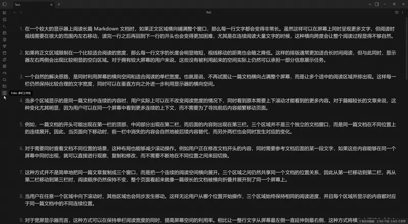
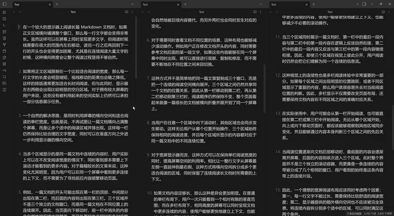
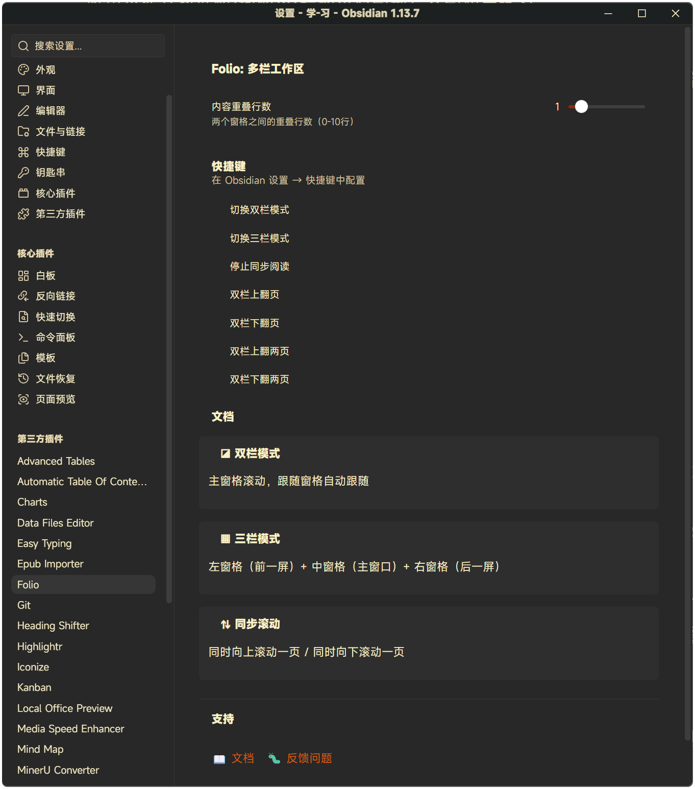

# MultiFolio User Guide

> This is the complete documentation. The README only carries the intro and the most common entry points — details live here.

## Dual Pane Mode

- **Primary View** on the left, **Next Screen** on the right
- Synchronized scrolling
- Perfect for continuous reading

## Triple Pane Mode

- **Previous Screen** on the left, **Primary View** in the center, **Next Screen** on the right
- See what comes before and after your current position
- Complete context awareness while editing

## Smart Synchronization

- Real-time bidirectional scroll sync
- Supports Edit, Preview, and Source modes
- Adjustable overlap between panes (0–10 lines)
- Seamless mode switching

## Easy Controls

- Toolbar icon with mode selection menu
- Quick keyboard shortcuts
- One-click mode switching
- Automatic cleanup when closing panes

## Usage

### Toolbar menu

Click the ◪ icon in the left toolbar to open MultiFolio's mode selection menu:

- **Dual Pane Mode** — main + right follower
- **Triple Pane Mode** — left + main + right followers
- **Stop** — close all follower panes

### Commands

All commands can be found in the Command Palette (Ctrl/Cmd + P):

| Command | Description |
|---------|-------------|
| Toggle Dual Pane Mode | Enable/disable dual pane workspace |
| Toggle Triple Pane Mode | Enable/disable triple pane workspace |
| Stop Synchronized Reading | Close all workspace panes |
| Page Up | Scroll up by one page |
| Page Down | Scroll down by one page |
| Double Page Up | Scroll up by two pages |
| Double Page Down | Scroll down by two pages |

### Recommended hotkeys

- **Dual Pane Mode**: `Ctrl/Cmd + Shift + D`
- **Triple Pane Mode**: `Ctrl/Cmd + Shift + T`
- **Stop synchronized reading**: `Ctrl/Cmd + Shift + Q`
- **Page Up**: `Ctrl/Cmd + ↑`
- **Page Down**: `Ctrl/Cmd + ↓`

## Settings

### Content overlap

Adjust the number of overlapping lines between panes (0–10 lines):

- **0**: No overlap, clean page breaks
- **2–3**: Recommended for smooth reading
- **5–10**: More context continuity

### Language

Interface language is automatically detected from Obsidian settings (English, 简体中文 / 繁體中文, 日本語, 한국어, Français, Deutsch, Español, العربية).

## Use cases

**For writers** — see previous context while writing, preview upcoming sections, maintain narrative flow across long documents.

**For readers** — read without page-turning interruptions, seamless scrolling, perfect for novels and long articles.

**For translators** — source text on the left, translation on the right, reference the next section while working.

**For reviewers** — compare sections side by side, full document context, efficient proofreading workflow.

## Compatibility

- Obsidian v1.8.7+
- Desktop: Windows, macOS, Linux · Mobile supported (`isDesktopOnly: false`)
- Supports Edit, Preview, and Source modes
- Works with all Markdown content

## Credits

This plugin is based on the original Folio plugin by [adeyahya](https://github.com/adeyahya). Thanks to the original author for the great idea and implementation.
